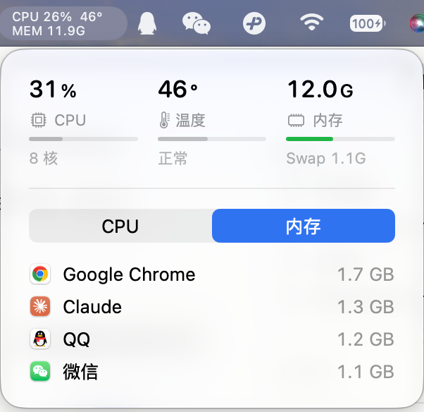

# MiniMonitor

极简 macOS 菜单栏监视器：CPU、温度、内存。单个 Swift 文件。



- 菜单栏常显 CPU / 温度 / 内存
- 面板显示内存压力和 Swap,以及占用最高的 App
- 高负载、过热、内存紧张时发系统通知
- 面板关闭时 CPU 占用约 1%

## 构建

需要 macOS 14+ 和 Command Line Tools。

```bash
./build.sh
open MiniMonitor.app
```

温度读取用了非公开接口，仅在 Apple 芯片上测试过。

## License

MIT
